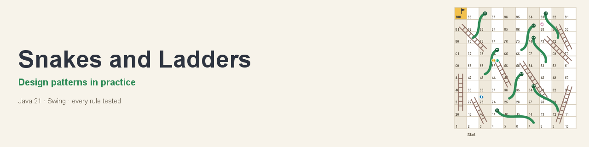
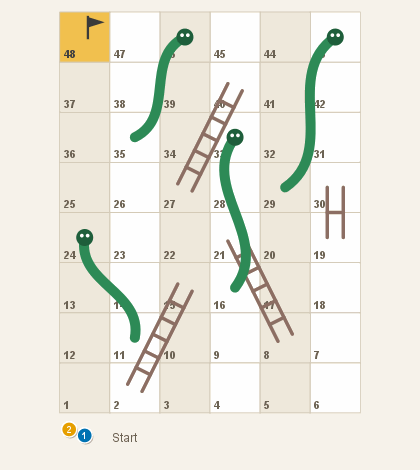
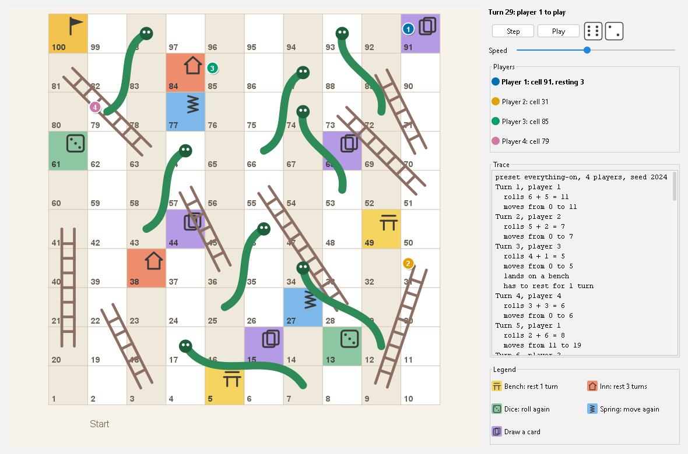
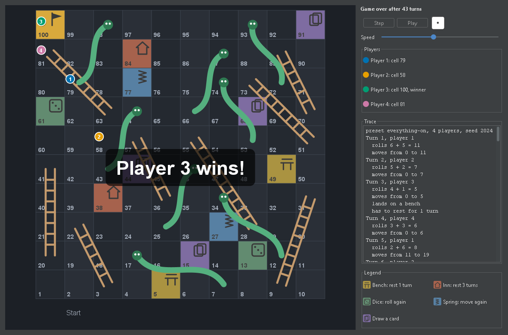
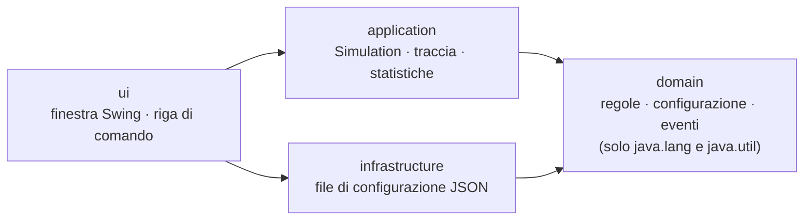

<p align="center">
  
</p>

<p align="center">
  Un simulatore di Scale e Serpenti che usa i design pattern solo dove servono, con ogni regola
  coperta da test.<br>
  <a href="README.md">English</a> · <b>Italiano</b>
</p>

<p align="center">
  <a href="https://github.com/GiuseppeCuiuri/Snakes-and-Ladders/actions/workflows/ci.yml"></a>
  <a href="https://github.com/GiuseppeCuiuri/Snakes-and-Ladders/actions/workflows/ci.yml"></a>
  <a href="LICENSE"></a>
  
  <a href="https://github.com/GiuseppeCuiuri/Snakes-and-Ladders/releases/latest"></a>
</p>

<p align="center">
  
</p>

## Perché questo progetto

Un'applicazione piccola ma completa, in cui il punto è l'ingegneria:

1. **Pattern solo dove risolvono un problema reale**, con il motivo scritto anche per quelli
   **scartati**: vedi [PATTERNS.md](docs/PATTERNS.md).
2. **Ogni regola testata**: uno scenario per ogni regola e per le sue interazioni, proprietà su
   centinaia di tabelloni casuali, e un seed che rigioca qualsiasi partita.
3. **Decisioni scritte**: i livelli, l'interpretazione delle regole e il formato dei file hanno
   ciascuno una breve scheda in [docs/adr](docs/adr).
4. **Regole fatte rispettare dalla build**: layering (ArchUnit), copertura, formattazione, stile e
   bug pattern.

## Funzionalità

Le regole (riassunte in [REQUIREMENTS.md](docs/REQUIREMENTS.md)):

- [x] Tabellone di R x C caselle, scale e serpenti, due dadi, arrivo esatto con rimbalzo, vince
  chi arriva primo
- [x] Qualsiasi dimensione: 10 x 10, 8 x 6, ... fino a 30 x 30
- [x] Un solo dado per tutta la partita
- [x] Un solo dado nelle ultime sei caselle (non in una partita a dado singolo)
- [x] Il doppio sei fa tirare di nuovo (non in una partita a dado singolo)
- [x] Caselle sosta: panchina (salta 1 turno) e locanda (salta 3)
- [x] Caselle premio: dadi (rilancia) e molla (avanza di nuovo dell'ultimo lancio)
- [x] Caselle "pesca una carta" con un vero mazzo: le carte tornano in fondo
- [x] La carta "divieto di sosta", conservata e usata per annullare una sosta
- [x] Configurazioni salvate e caricate in JSON versionato, con le posizioni di scale e serpenti
- [x] Una finestra con avanzamento passo passo e automatico, e la traccia testuale di ogni turno

Inoltre:

- [x] Riga di comando con la stessa traccia, e migliaia di partite in batch con statistiche
- [x] Replay dal seed: stessa configurazione e stesso seed danno sempre la stessa partita
- [x] Tabelloni casuali sempre validi, e un tabellone disegnato in Java2D
- [x] Tema chiaro e scuro (FlatLaf), scorciatoie da tastiera, finestra ridimensionabile

<p align="center">
  
  
</p>

## Avvio rapido

Serve **Java 21 o successivo**.

```bash
# 1. Scarica snakes-and-ladders-1.0.0.jar dalla pagina Releases, poi apri la finestra:
java -jar snakes-and-ladders-1.0.0.jar

# 2. Oppure guarda una partita nel terminale (lo stesso seed rigioca sempre la stessa partita):
java -jar snakes-and-ladders-1.0.0.jar --players 3 --preset compact-48 --seed 42

# 3. Oppure compilalo tu, con tutti i test e i controlli:
./mvnw verify          # su Windows: mvnw.cmd verify; il jar finisce in target/
```

Nella finestra, **Spazio** gioca un turno e **P** avvia o mette in pausa il gioco automatico.
*Game → New game* sceglie un preset o un tabellone casuale, le regole e i giocatori.

<details>
<summary>Cosa mostra il terminale</summary>

```text
preset compact-48, 3 players, seed 42
Turn 1, player 1
  rolls 6 + 1 = 7
  moves from 0 to 7
Turn 2, player 2
  rolls 4 + 1 = 5
  moves from 0 to 5
...
Turn 55, player 1
  rolls 3
  moves from 45 to 48
Player 1 wins on turn 55
```

`--games 10000` gioca diecimila partite in meno di un secondo e stampa le statistiche:

```text
preset everything-on, 4 players, seed 42
Games: 10000, without a winner: 0
Player 1 won 2748 games (27.5%)
Player 2 won 2483 games (24.8%)
Player 3 won 2462 games (24.6%)
Player 4 won 2307 games (23.1%)
Turns per game: 55.1 on average, 16 at least, 178 at most
Most landed-on cells: 99 (16702 times) 98 (15528 times) 97 (12758 times) 100 (10000 times) 96 (9731 times)
```

</details>

L'interfaccia e la traccia sono in inglese.

## Configurazione

I tabelloni sono semplice JSON, leggibile e modificabile a mano. Tre preset sono inclusi
nell'applicazione ([`configs/`](configs/)), e *Game → Save configuration* scrive lo stesso
formato:

```json
{
  "schemaVersion" : 1,
  "rows" : 10,
  "columns" : 10,
  "dice" : 2,
  "singleDieNearEnd" : true,
  "doubleSixBonus" : true,
  "ladders" : [ { "from" : 9, "to" : 31 } ],
  "snakes" : [ { "from" : 17, "to" : 7 }, { "from" : 98, "to" : 79 } ],
  "specials" : [ { "cell" : 20, "type" : "INN" }, { "cell" : 45, "type" : "DRAW_CARD" } ],
  "deck" : [ "BENCH", "INN", "DICE", "SPRING", "NO_REST" ]
}
```

I file sono controllati in modo rigoroso: un campo sconosciuto, una scala che scende o una casella
speciale sulla testa di un serpente vengono rifiutati con un messaggio che dice esattamente cosa e
dove.

## Mappa dei pattern

| Pattern | Problema che risolve qui | Codice |
|---|---|---|
| [Command](docs/PATTERNS.md#command-special-cells-and-cards) | le caselle speciali e le carte che le imitano eseguono gli stessi oggetti azione | [`Special`](src/main/java/io/github/giuseppecuiuri/snakesandladders/domain/Special.java), [`Card`](src/main/java/io/github/giuseppecuiuri/snakesandladders/domain/Card.java) |
| [Observer](docs/PATTERNS.md#observer-typed-game-events) | traccia, animazione e statistiche seguono la partita tramite eventi tipizzati e sealed | [`Game`](src/main/java/io/github/giuseppecuiuri/snakesandladders/domain/Game.java), [`GameEvent`](src/main/java/io/github/giuseppecuiuri/snakesandladders/domain/GameEvent.java) |
| [Static factory](docs/PATTERNS.md#static-factory-random-boards) | tabelloni casuali che rispettano sempre le regole | [`RandomBoards`](src/main/java/io/github/giuseppecuiuri/snakesandladders/domain/RandomBoards.java) |
| [Builder](docs/PATTERNS.md#builder-game-configuration) | costruzione leggibile e validazione in un colpo solo di una configurazione con nove campi | [`GameConfig.Builder`](src/main/java/io/github/giuseppecuiuri/snakesandladders/domain/GameConfig.java) |
| [DTO + Repository](docs/PATTERNS.md#dto--repository-configuration-files) | un formato di file versionato, separato dal dominio | [`ConfigFileV1`](src/main/java/io/github/giuseppecuiuri/snakesandladders/infrastructure/ConfigFileV1.java), [`ConfigRepository`](src/main/java/io/github/giuseppecuiuri/snakesandladders/infrastructure/ConfigRepository.java) |
| [Facade](docs/PATTERNS.md#facade-simulation) | un unico punto d'ingresso che crea e inizializza col seed ogni partita, per finestra e riga di comando | [`Simulation`](src/main/java/io/github/giuseppecuiuri/snakesandladders/application/Simulation.java) |
| [Scartati](docs/PATTERNS.md#patterns-considered-and-rejected) | Strategy, State, Iterator, Template Method, Memento, Singleton, e perché no | |

La documentazione tecnica in `docs/` è in inglese.

## Architettura



Quattro livelli con dipendenze solo verso il basso, verificate da
[test ArchUnit](src/test/java/io/github/giuseppecuiuri/snakesandladders/ArchitectureTest.java).
Dettagli, diagrammi UML e decisioni: [ARCHITECTURE.md](docs/ARCHITECTURE.md) e [docs/adr](docs/adr).

## Test e qualità

`./mvnw verify` esegue 97 test automatici e fallisce se uno di questi controlli non passa:

| Controllo | Strumento |
|---|---|
| Scenari delle regole, compresi esempi svolti | JUnit 5, AssertJ |
| Proprietà su centinaia di tabelloni casuali: le pedine restano sul tabellone, i seed rigiocano le partite | jqwik |
| Layering, dominio che usa solo il JDK, solo campi statici final, casualità creata in un solo livello | ArchUnit |
| Almeno l'80% di copertura di righe e rami del dominio (oggi 99,7% e 95,5%) | JaCoCo |
| Formattazione, stile, bug pattern | Spotless (google-java-format), Checkstyle, SpotBugs |

La finestra è testata senza schermo, e il banner, gli screenshot e la GIF di questa pagina sono
disegnati dall'applicazione stessa (`Screenshots` nei sorgenti di test). Contando anche la
finestra, la cui interazione è verificata a mano, i test coprono circa l'80% di tutte le righe.
La CI compila su Linux, Windows e macOS con Java 21 e 25.

## Struttura del repository

```text
src/main/java/io/github/giuseppecuiuri/snakesandladders/
  domain/          regole: Game, Turn, GameConfig, Special, Card, GameEvent, RandomBoards
  application/     Simulation (partite con seed, batch), TraceFormatter, Stats
  infrastructure/  ConfigRepository e il formato di file ConfigFileV1
  ui/              Main, cli/Cli, swing/ (finestra, disegno del tabellone, dialog)
src/test/java/...  test per livello, ArchitectureTest, lo strumento Screenshots
configs/           i tre tabelloni preset
docs/              pattern, architettura, requisiti, ADR, UML
```

## Cosa non c'è

- **Multiplayer online**: servirebbero un server e degli account.
- **Annulla mossa**: una partita si può rigiocare dal suo seed.

Possibili sviluppi: traduzione italiana dell'interfaccia, installer nativi con `jpackage`,
mutation testing con PIT.

## Crediti e licenza

Realizzato da **Giuseppe Cuiuri** ([@GiuseppeCuiuri](https://github.com/GiuseppeCuiuri)). È nato
durante il corso di *Ingegneria del Software* all'Università della Calabria. Il tabellone, le sue
icone e le immagini in `docs/assets` sono originali e disegnati dall'applicazione.

Rilasciato con [licenza MIT](LICENSE). I contributi sono benvenuti: vedi
[CONTRIBUTING.md](CONTRIBUTING.md).
