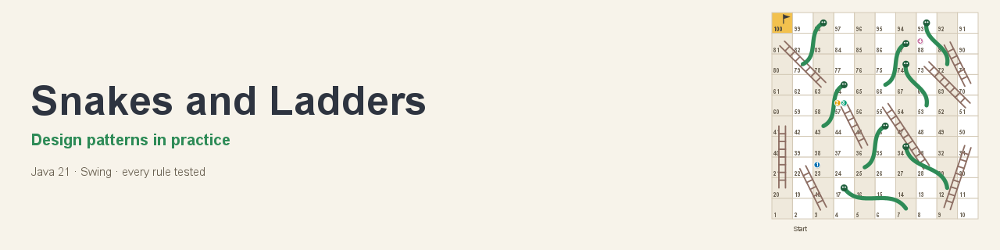
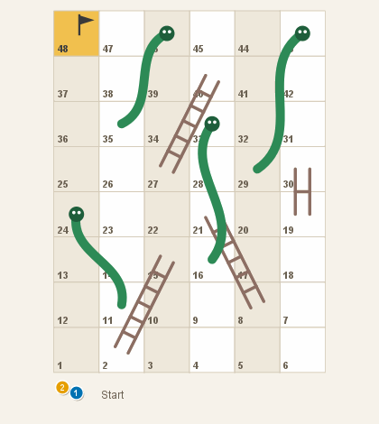
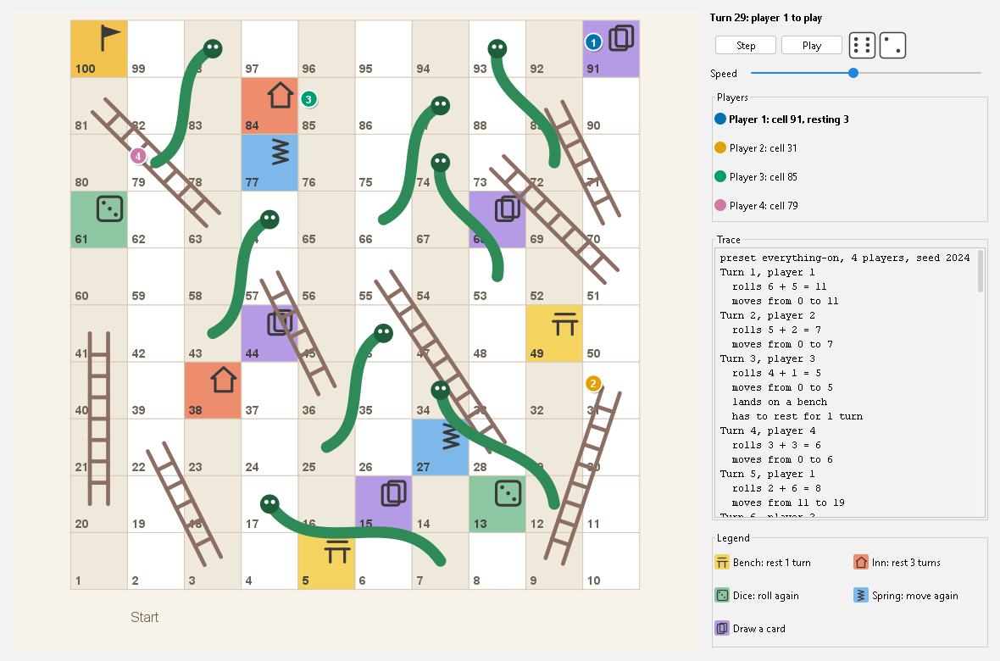
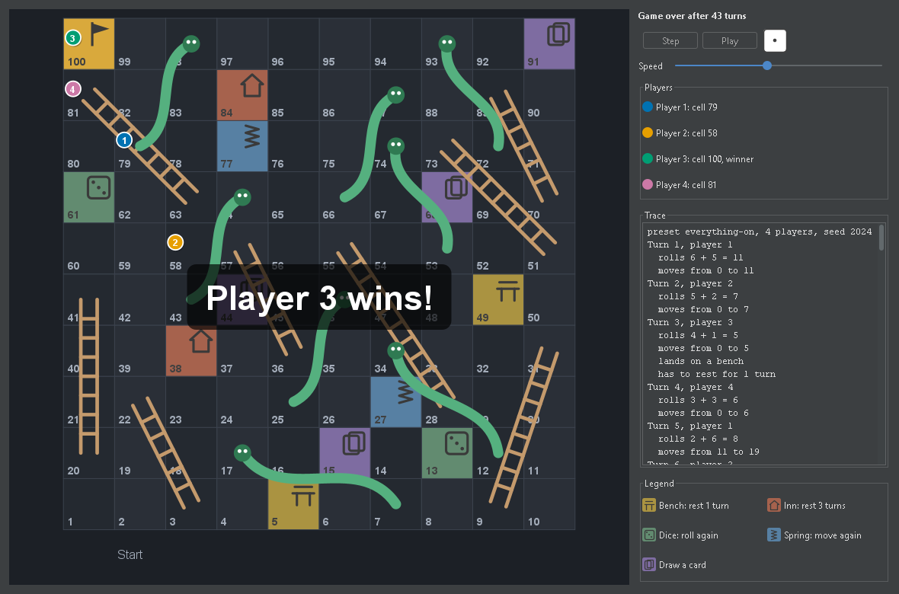
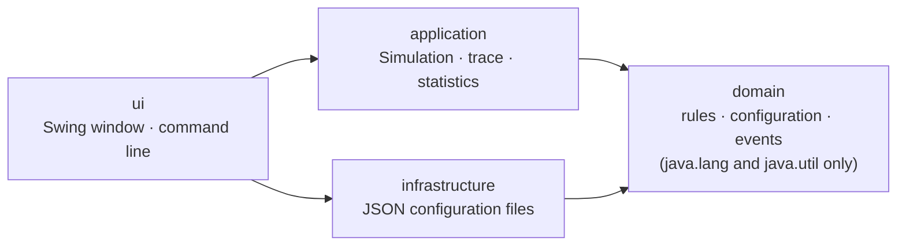

<p align="center">
  
</p>

<p align="center">
  A Snakes and Ladders simulator that puts software-design patterns to work for a reason,
  with every rule tested.<br>
  <b>English</b> · <a href="README.it.md">Italiano</a>
</p>

<p align="center">
  <a href="https://github.com/GiuseppeCuiuri/Snakes-and-Ladders/actions/workflows/ci.yml"></a>
  <a href="https://github.com/GiuseppeCuiuri/Snakes-and-Ladders/actions/workflows/ci.yml"></a>
  <a href="LICENSE"></a>
  
  <a href="https://github.com/GiuseppeCuiuri/Snakes-and-Ladders/releases/latest"></a>
</p>

<p align="center">
  
</p>

## Why this project

A small but complete application where the engineering is the point:

1. **Patterns where they solve a real problem**, and a written reason for each one that was
   **rejected**: see [PATTERNS.md](docs/PATTERNS.md).
2. **Every rule tested**: a scenario for each rule and its interactions, properties on hundreds of
   random boards, and a seed that replays any game.
3. **Decisions written down**: the layers, the rule interpretations and the file format each have
   a short record in [docs/adr](docs/adr).
4. **Rules enforced by the build**: layering (ArchUnit), coverage, formatting, style and bug
   patterns.

## Features

The rules (summarised in [REQUIREMENTS.md](docs/REQUIREMENTS.md)):

- [x] Board of R x C cells, ladders and snakes, two dice, exact landing with bounce, first to the
  end wins
- [x] Any size: 10 x 10, 8 x 6, ... up to 30 x 30
- [x] A single die for the whole game
- [x] A single die on the last six cells (not in a single-die game)
- [x] A double six earns another roll (not in a single-die game)
- [x] Rest cells: bench (skip 1 turn) and inn (skip 3)
- [x] Bonus cells: dice (roll again) and spring (move again by the last roll)
- [x] Draw-a-card cells with a real deck: cards go back to the bottom
- [x] The no-rest card, kept and used to cancel a rest
- [x] Configurations saved and loaded as versioned JSON, ladder and snake positions included
- [x] A window with step-by-step and automatic play, and a text trace of every turn

Also:

- [x] Command line with the same text trace, and batches of thousands of games with statistics
- [x] Replay by seed: the same configuration and seed always give the same game
- [x] Random boards that always respect the rules, and a board drawn with Java2D
- [x] Light and dark theme (FlatLaf), keyboard shortcuts, a resizable window

<p align="center">
  
  
</p>

## Quick start

You need **Java 21 or newer**.

```bash
# 1. Download snakes-and-ladders-1.0.0.jar from the Releases page, then open the window:
java -jar snakes-and-ladders-1.0.0.jar

# 2. Or watch a game in the terminal (the same seed always replays the same game):
java -jar snakes-and-ladders-1.0.0.jar --players 3 --preset compact-48 --seed 42

# 3. Or build it yourself, with every test and check:
./mvnw verify          # Windows: mvnw.cmd verify; the jar ends up in target/
```

In the window, **Space** plays one turn and **P** starts or pauses automatic play. *Game → New
game* chooses a preset or a random board, the rules and the players.

<details>
<summary>What the terminal shows</summary>

```text
preset compact-48, 3 players, seed 42
Turn 1, player 1
  rolls 6 + 1 = 7
  moves from 0 to 7
Turn 2, player 2
  rolls 4 + 1 = 5
  moves from 0 to 5
...
Turn 55, player 1
  rolls 3
  moves from 45 to 48
Player 1 wins on turn 55
```

`--games 10000` plays ten thousand games in under a second and prints statistics:

```text
preset everything-on, 4 players, seed 42
Games: 10000, without a winner: 0
Player 1 won 2748 games (27.5%)
Player 2 won 2483 games (24.8%)
Player 3 won 2462 games (24.6%)
Player 4 won 2307 games (23.1%)
Turns per game: 55.1 on average, 16 at least, 178 at most
Most landed-on cells: 99 (16702 times) 98 (15528 times) 97 (12758 times) 100 (10000 times) 96 (9731 times)
```

</details>

## Configuration

Boards are plain JSON, readable and editable by hand. Three presets ship with the application
([`configs/`](configs/)), and *Game → Save configuration* writes the same format:

```json
{
  "schemaVersion" : 1,
  "rows" : 10,
  "columns" : 10,
  "dice" : 2,
  "singleDieNearEnd" : true,
  "doubleSixBonus" : true,
  "ladders" : [ { "from" : 9, "to" : 31 } ],
  "snakes" : [ { "from" : 17, "to" : 7 }, { "from" : 98, "to" : 79 } ],
  "specials" : [ { "cell" : 20, "type" : "INN" }, { "cell" : 45, "type" : "DRAW_CARD" } ],
  "deck" : [ "BENCH", "INN", "DICE", "SPRING", "NO_REST" ]
}
```

Files are checked strictly: an unknown field, a ladder going down or a special cell on a snake's
head is rejected with a message that says exactly what and where.

## Pattern map

| Pattern | Problem it solves here | Code |
|---|---|---|
| [Command](docs/PATTERNS.md#command-special-cells-and-cards) | special cells and the cards that copy them run the same action objects | [`Special`](src/main/java/io/github/giuseppecuiuri/snakesandladders/domain/Special.java), [`Card`](src/main/java/io/github/giuseppecuiuri/snakesandladders/domain/Card.java) |
| [Observer](docs/PATTERNS.md#observer-typed-game-events) | trace, animation and statistics follow the game through typed, sealed events | [`Game`](src/main/java/io/github/giuseppecuiuri/snakesandladders/domain/Game.java), [`GameEvent`](src/main/java/io/github/giuseppecuiuri/snakesandladders/domain/GameEvent.java) |
| [Static factory](docs/PATTERNS.md#static-factory-random-boards) | random boards that always respect the rules | [`RandomBoards`](src/main/java/io/github/giuseppecuiuri/snakesandladders/domain/RandomBoards.java) |
| [Builder](docs/PATTERNS.md#builder-game-configuration) | readable construction and one-shot validation of a nine-field configuration | [`GameConfig.Builder`](src/main/java/io/github/giuseppecuiuri/snakesandladders/domain/GameConfig.java) |
| [DTO + Repository](docs/PATTERNS.md#dto--repository-configuration-files) | a versioned file format kept apart from the domain | [`ConfigFileV1`](src/main/java/io/github/giuseppecuiuri/snakesandladders/infrastructure/ConfigFileV1.java), [`ConfigRepository`](src/main/java/io/github/giuseppecuiuri/snakesandladders/infrastructure/ConfigRepository.java) |
| [Facade](docs/PATTERNS.md#facade-simulation) | one entry point that seeds every game, for the window and the command line | [`Simulation`](src/main/java/io/github/giuseppecuiuri/snakesandladders/application/Simulation.java) |
| [Rejected](docs/PATTERNS.md#patterns-considered-and-rejected) | Strategy, State, Iterator, Template Method, Memento, Singleton, and why not | |

## Architecture



Four layers whose dependencies only point downwards, checked by
[ArchUnit tests](src/test/java/io/github/giuseppecuiuri/snakesandladders/ArchitectureTest.java).
Details, UML diagrams and the decisions behind them: [ARCHITECTURE.md](docs/ARCHITECTURE.md) and
[docs/adr](docs/adr).

## Tests and quality

`./mvnw verify` runs 97 automated tests and fails on any of these:

| Check | Tool |
|---|---|
| Rule scenarios, including worked examples | JUnit 5, AssertJ |
| Properties on hundreds of random boards: tokens stay on the board, seeds replay games | jqwik |
| Layering, a JDK-only domain, final static fields only, randomness created in one layer | ArchUnit |
| At least 80% line and branch coverage of the domain (currently 99.7% and 95.5%) | JaCoCo |
| Formatting, style, bug patterns | Spotless (google-java-format), Checkstyle, SpotBugs |

The window is tested without a screen, and the banner, the screenshots and the GIF on this page
are rendered by the application itself (`Screenshots` in the test sources). Counting the window,
whose interaction is checked by hand, the tests cover about 80% of all lines. The CI builds on
Linux, Windows and macOS with Java 21 and 25.

## Repository layout

```text
src/main/java/io/github/giuseppecuiuri/snakesandladders/
  domain/          rules: Game, Turn, GameConfig, Special, Card, GameEvent, RandomBoards
  application/     Simulation (seeded games, batches), TraceFormatter, Stats
  infrastructure/  ConfigRepository and the ConfigFileV1 file format
  ui/              Main, cli/Cli, swing/ (window, board renderer, dialog)
src/test/java/...  tests per layer, ArchitectureTest, the Screenshots tool
configs/           the three preset boards
docs/              patterns, architecture, requirements, ADRs, UML
```

## Not included

- **Online multiplayer**: it would need a server and accounts.
- **Undo**: a game can be replayed from its seed.

Possible next steps: an Italian translation of the interface, native installers with `jpackage`,
mutation testing with PIT.

## Credits and licence

Created by **Giuseppe Cuiuri** ([@GiuseppeCuiuri](https://github.com/GiuseppeCuiuri)). It started
during the *Software Engineering* course at the University of Calabria. The board, its icons and
the images in `docs/assets` are original and drawn by the application.

Released under the [MIT licence](LICENSE). Contributions are welcome: see
[CONTRIBUTING.md](CONTRIBUTING.md).
