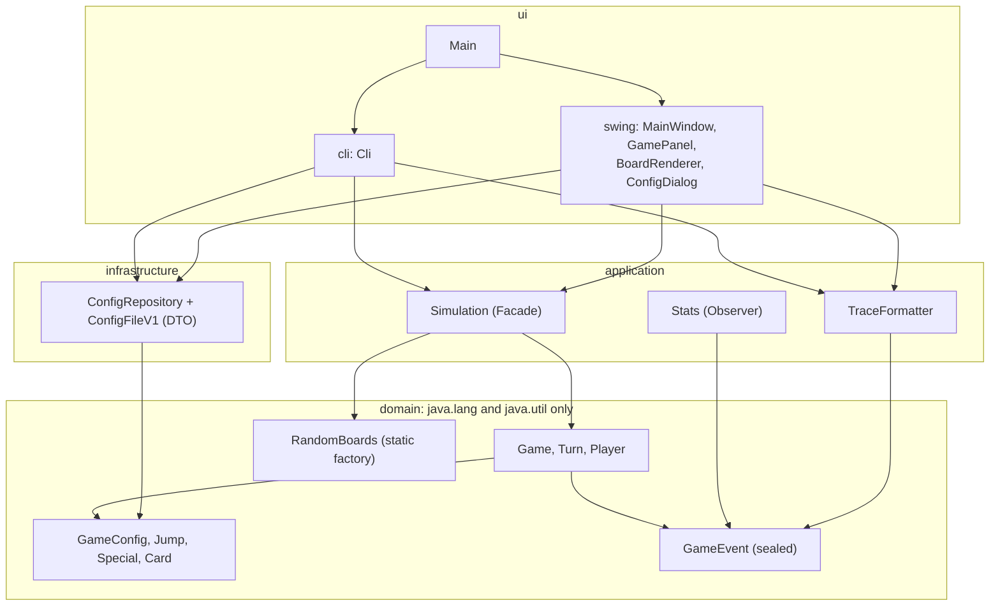
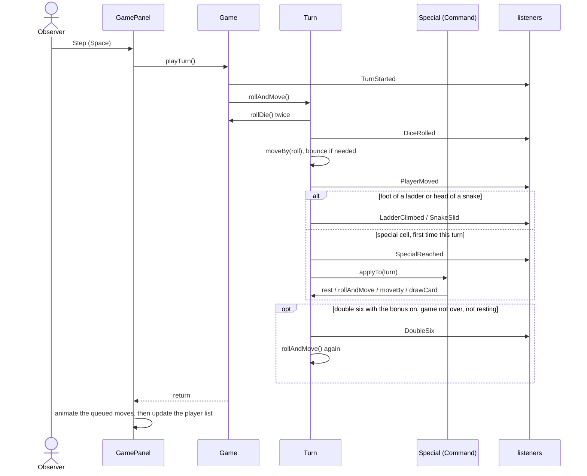

# Architecture

## Static view: four layers

| Layer | Responsibility | Depends on |
|---|---|---|
| `domain` | the rules: configuration and its validation, turns, special cells, cards, events | `java.lang`, `java.util` |
| `application` | games seeded from a number, the text trace, statistics | `domain` |
| `infrastructure` | configuration files (JSON, Jackson) | `domain` |
| `ui` | the Swing window, the command line and the launcher | everything above |

The rules are checked by [`ArchitectureTest`](../src/test/java/io/github/giuseppecuiuri/snakesandladders/ArchitectureTest.java)
on every build:
- each layer only depends downwards;
- the domain uses nothing but `java.lang` and `java.util`;
- only the command line writes to the console;
- every static field is final;
- the command line needs no graphics;
- only the application layer creates random generators.

Full UML diagrams, with their PlantUML sources:
[components](uml/components.svg), [domain model](uml/domain-classes.svg),
[use cases](uml/use-cases.svg), [one turn](uml/turn-sequence.svg).

## Dynamic view: one turn

`Game.playTurn` computes the whole turn at once and reports it as events. The GUI queues the moves
those events describe and animates them afterwards with a Swing `Timer`, so the model never waits
for the screen.

## Threads

Everything runs on the Swing event thread: a turn takes microseconds, so there is no background
worker to synchronise. Automatic play is a `javax.swing.Timer` that plays the next turn once the
previous animation has finished.

## Randomness and replay

The only source of randomness is the `RandomGenerator` given to `Game`. `Simulation` creates it
from a seed, `SplittableRandom(seed)`, and also shuffles the deck with it. The same
configuration and seed therefore replay the same game, in the window ("Restart"), on the command
line (`--seed`) and in tests, which pass a scripted generator instead.

## Configuration files

`ConfigRepository` reads and writes the versioned JSON format through the `ConfigFileV1` DTO
([ADR-0004](adr/0004-versioned-json-configuration-files.md)). The three presets in `configs/`
are packaged into the jar and loaded from the classpath by name.

## Packaging

`./mvnw verify` builds one executable jar with Jackson and FlatLaf inside (Maven Shade).
`ui.Main` opens the window when started without arguments and a screen is available; otherwise
it runs the command line.

## Quality gates

| Gate | Tool | Fails the build when |
|---|---|---|
| Unit, scenario and property tests | JUnit 5, AssertJ, jqwik | any test fails |
| Architecture | ArchUnit | a layering or design rule is broken |
| Coverage | JaCoCo | the `domain` package drops below 80% of lines or branches |
| Formatting | Spotless (google-java-format) | the code is not formatted |
| Style | Checkstyle (Google checks) | any violation |
| Bug patterns | SpotBugs | any bug at its default threshold (medium priority and above) |

## Decisions

| ADR | Decision |
|---|---|
| [0001](adr/0001-java-21-baseline.md) | Java 21, for exhaustive `switch` over sealed events |
| [0002](adr/0002-layered-architecture-checked-by-tests.md) | Four layers, checked by tests |
| [0003](adr/0003-rule-interpretations.md) | One fixed answer for each way the rules interact |
| [0004](adr/0004-versioned-json-configuration-files.md) | Versioned JSON configuration files instead of Java serialization |
