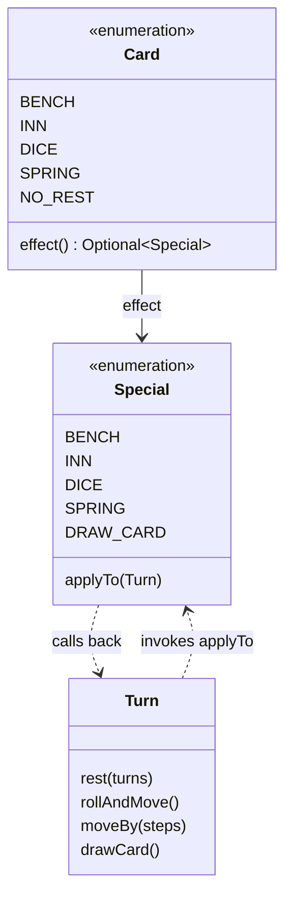
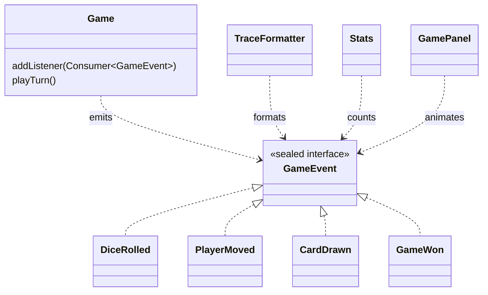

# Design patterns

This page lists each pattern the project uses, the problem it solves in this game, where it lives,
how it is tested, and what it costs. It also lists the patterns that were considered and
**rejected**, with the reason.

| Pattern | Where | Proven by |
|---|---|---|
| [Command](#command-special-cells-and-cards) | `domain.Special`, `domain.Card` | `GameTest` (rest, bonus, draw-card, no-rest cases) |
| [Observer](#observer-typed-game-events) | `domain.Game` → `GameEvent` → listeners | `GameTest`, `TraceFormatterTest`, `StatsTest` |
| [Static factory](#static-factory-random-boards) | `domain.RandomBoards` | `RandomBoardsTest`, `GamePropertiesTest` |
| [Builder](#builder-game-configuration) | `domain.GameConfig.Builder` | `GameConfigTest` |
| [DTO + Repository](#dto--repository-configuration-files) | `infrastructure.ConfigFileV1`, `ConfigRepository` | `ConfigRepositoryTest` |
| [Facade](#facade-simulation) | `application.Simulation` | `SimulationTest`, `CliTest` |
| [Dependency injection](#dependency-injection-the-random-generator) | `RandomGenerator` passed to `Game` | every scripted-dice test |
| [Rejected patterns](#patterns-considered-and-rejected) | Strategy, State, Iterator, Template Method, Memento, Singleton, GoF Factory Method | |

The source links point at the lines in question.

---

## Command: special cells and cards

**Problem.** Landing on a special cell triggers an action: rest for one or three turns, roll again
or move again, draw a card. A drawn card has the same effect as the matching cell. The turn must
run any of these without a chain of `if`s on the cell type.

**Solution.** Each constant of the enum
[`Special`](../src/main/java/io/github/giuseppecuiuri/snakesandladders/domain/Special.java#L9) is
an immutable command with its own
[`applyTo(Turn)`](../src/main/java/io/github/giuseppecuiuri/snakesandladders/domain/Special.java#L51).
The [`Turn`](../src/main/java/io/github/giuseppecuiuri/snakesandladders/domain/Turn.java#L8) is
the receiver: it offers the primitive operations `rest`, `rollAndMove`, `moveBy` and `drawCard`.
The invokers are
[`Turn.resolve`](../src/main/java/io/github/giuseppecuiuri/snakesandladders/domain/Turn.java#L102)
for cells and
[`Turn.drawCard`](../src/main/java/io/github/giuseppecuiuri/snakesandladders/domain/Turn.java#L65)
for cards. A [`Card`](../src/main/java/io/github/giuseppecuiuri/snakesandladders/domain/Card.java#L12)
holds the very same `Special` constant as its
[`effect()`](../src/main/java/io/github/giuseppecuiuri/snakesandladders/domain/Card.java#L39),
so "same effect as the cell" holds by construction. The deck is in effect a queue of these
commands: each one runs when its card is drawn.



**Trade-offs.** Enum constants carry no per-cell data (a bench always rests one turn), which is
exactly what the rules need. Adding a cell type touches a few places outside the enum;
`CONTRIBUTING.md` lists them, and the compiler finds most of them. There is no undo, because
nothing asks for it.

**Tests.** `GameTest.RestCells`, `GameTest.BonusCells`, `GameTest.DrawCards` and
`GameTest.NoRestCard`, for example
[`eachCardHasTheEffectOfTheMatchingCell`](../src/test/java/io/github/giuseppecuiuri/snakesandladders/domain/GameTest.java#L395).

---

## Observer: typed game events

**Problem.** Several parts of the program must follow a game: the text trace (on the console and in
the window), the animation of the board, and the statistics. None of them should reach into the
game's state, and the rules should not know that any of them exists.

**Solution.** [`Game`](../src/main/java/io/github/giuseppecuiuri/snakesandladders/domain/Game.java#L23)
is the subject: listeners register with
[`addListener`](../src/main/java/io/github/giuseppecuiuri/snakesandladders/domain/Game.java#L69)
and receive every
[`GameEvent`](../src/main/java/io/github/giuseppecuiuri/snakesandladders/domain/GameEvent.java#L12)
in order. Events are immutable records in a **sealed** hierarchy, so each consumer handles them
with an exhaustive `switch`: a new event type does not compile until every consumer handles it
(ADR-0001). The consumers are
[`TraceFormatter`](../src/main/java/io/github/giuseppecuiuri/snakesandladders/application/TraceFormatter.java#L29),
[`Stats`](../src/main/java/io/github/giuseppecuiuri/snakesandladders/application/Stats.java#L42)
and the GUI's
[`GamePanel.onEvent`](../src/main/java/io/github/giuseppecuiuri/snakesandladders/ui/swing/GamePanel.java#L304).



The listener type is the JDK's `Consumer<GameEvent>`: a custom `Observer` interface would add a
name and nothing else.

**Trade-offs.** Listeners run synchronously in the middle of a turn. They receive immutable
records, so they cannot change the game, and the game updates its own state before emitting (for
example, a drawn card is back in the deck first). They must not throw, though: an exception stops
the turn halfway and leaves that game unusable. Events describe the outcome, not the board, so the
GUI keeps its own animated positions.

**Tests.** [`eachTurnReportsWhatHappenedInOrder`](../src/test/java/io/github/giuseppecuiuri/snakesandladders/domain/GameTest.java#L74)
in `GameTest`, plus `TraceFormatterTest` and `StatsTest`.

---

## Static factory: random boards

**Problem.** The window offers random boards with a given number of ladders, snakes and special
cells. They must respect every rule: no shared ends, different rows, no special cell on a ladder
or snake end. Generation must also end on any request, including boards too small or too crowded
for it.

**Solution.**
[`RandomBoards.builder`](../src/main/java/io/github/giuseppecuiuri/snakesandladders/domain/RandomBoards.java#L30)
creates a `GameConfig.Builder` filled with valid random placements. It checks first that the
request can fit, and it picks only among cells that are still valid, so it always terminates. The
choice of behaviour by type needs no factory at all: the `Special` enum is the registry
(`valueOf` reads the JSON, `values()` enumerates the types).

**Not a GoF pattern.** `RandomBoards` is a *static factory method* in the sense of *Effective
Java*: one method that hides how a valid board is built. No subclass would ever override the
creation, so a creator hierarchy would add nothing.

**Trade-offs.** The placement is greedy: on a very crowded board it can give up even though some
arrangement exists, and another seed usually works. The jqwik property test skips those boards
explicitly.

**Tests.** `RandomBoardsTest`, for example the 300 seeds of
`everyGeneratedBoardIsValid`, and `GamePropertiesTest`.

---

## Builder: game configuration

**Problem.**
[`GameConfig`](../src/main/java/io/github/giuseppecuiuri/snakesandladders/domain/GameConfig.java#L28)
is an immutable record with nine components, two of them booleans. Built positionally it is
unreadable: is `true, false` "single die near the end" or "double six"? Tests, the dialog, the JSON
loader and the random generator all build configurations step by step, and the validation must
run once, on the complete result.

**Solution.** The fluent
[`GameConfig.Builder`](../src/main/java/io/github/giuseppecuiuri/snakesandladders/domain/GameConfig.java#L191)
collects the parts. `build()` calls the record's
[compact constructor](../src/main/java/io/github/giuseppecuiuri/snakesandladders/domain/GameConfig.java#L46),
which checks every rule and reports all the problems at once, one per line, so the GUI can show
them together.

```java
GameConfig config = GameConfig.builder(10, 10)
    .singleDieNearEnd(true)
    .ladder(9, 31)
    .snake(17, 7)
    .special(20, Special.INN)
    .build();
```

**No Director.** The presets (`classic-100`, `compact-48`, `everything-on`) are data in
`configs/`, so a Director would only duplicate them in code.

**Tests.** `GameConfigTest`, which covers every validation rule and the all-problems-at-once
message.

---

## DTO + Repository: configuration files

**Problem.** Configurations must be saved and loaded with every ladder and snake in place, in a
format a person can read. Java serialization would be the shortest way, but its files are opaque,
and reading a serialized object from a file is a known security risk.

**Solution.** [`ConfigFileV1`](../src/main/java/io/github/giuseppecuiuri/snakesandladders/infrastructure/ConfigFileV1.java#L13)
is a Data Transfer Object that mirrors the JSON file field by field and converts to and from the
domain record. [`ConfigRepository`](../src/main/java/io/github/giuseppecuiuri/snakesandladders/infrastructure/ConfigRepository.java#L38)
is the Repository: `load`, `save`, `parse`, `toJson` and `preset`. The file is versioned
(`schemaVersion`) and read strictly. A format error names its JSON path, or its line and column
when the JSON itself is broken; a rule error names the cells involved (ADR-0004).

**Trade-offs.** It is a repository in the broad sense: it hides where configurations are kept and
in which format, but it has no query methods, because nothing needs to search them. There is a
single storage, so the repository is a class, not an interface. A second format version will need
a second DTO and a migration step at the point where `schemaVersion` is read.

**Tests.** `ConfigRepositoryTest`: round trips, the exact saved format, the presets, and every
kind of invalid file.

---

## Facade: Simulation

**Problem.** The window and the command line both create seeded games, random boards and batches
of games. Randomness must be created in one place, so that a seed replays a game: the
architecture tests forbid creating random generators anywhere else.

**Solution.**
[`Simulation`](../src/main/java/io/github/giuseppecuiuri/snakesandladders/application/Simulation.java#L15)
offers `newGame(config, players, seed)`, `randomBoard(...)`, `newSeed()`, `batch(...)` and
`playToTheEnd(...)`. The user interfaces never construct a random generator.

**Trade-offs.** The facade is deliberately thin: to play turns and listen to events the
interfaces use `Game` directly, because it is the domain's aggregate and wrapping it would only
add pass-through methods.

**Tests.** `SimulationTest` (same seed, same game; batches; turn limit) and `CliTest`.

---

## Dependency injection: the random generator

`Game` receives its `java.util.random.RandomGenerator` in the constructor
([`Game(GameConfig, int, RandomGenerator)`](../src/main/java/io/github/giuseppecuiuri/snakesandladders/domain/Game.java#L49)).
Tests pass a `ScriptedRandom` that returns exactly the faces a scenario needs, such as the
worked examples of the rules. The application passes a `SplittableRandom` seeded by the user.
This is what makes the golden tests possible, and what lets `--seed 42` replay a game.

---

## Patterns considered and rejected

| Pattern | Considered for | Why not |
|---|---|---|
| **Strategy** | the three dice rules | The rules are one `int` and two booleans read in a three-line expression (`Turn.rollAndMove`). An interface with three implementations would be more code than the rule itself. Their incompatibilities (a single-die game excludes the other two) are validation rules in `GameConfig`. |
| **State** | a player resting, a player with a no-rest card | The whole state is two counters on `Player` (`restTurns`, `noRestCards`) and the winner on `Game`. State objects would spread two `if`s over several classes. |
| **Iterator** | the turn order | `(current + 1) % players` is the whole iteration. |
| **Template Method** | the steps of a turn for each variant | The variants are configuration flags, not subclasses, so there is nothing to override. |
| **Memento** | undo or replay | Nothing asks for undo, and a replay is configuration + seed. |
| **Singleton** | the game, the random generator | Global state would make games impossible to test in isolation or to replay. ArchUnit requires every static field to be final. |
| **GoF Factory Method** | creating cells | No creator subclass would override anything; see the note under [Static factory](#static-factory-random-boards). |
| **Macro command** | "move, then apply the cell" | It is one method, `Turn.moveBy`, which moves and then resolves the cell reached; a composite object would add nothing. |
